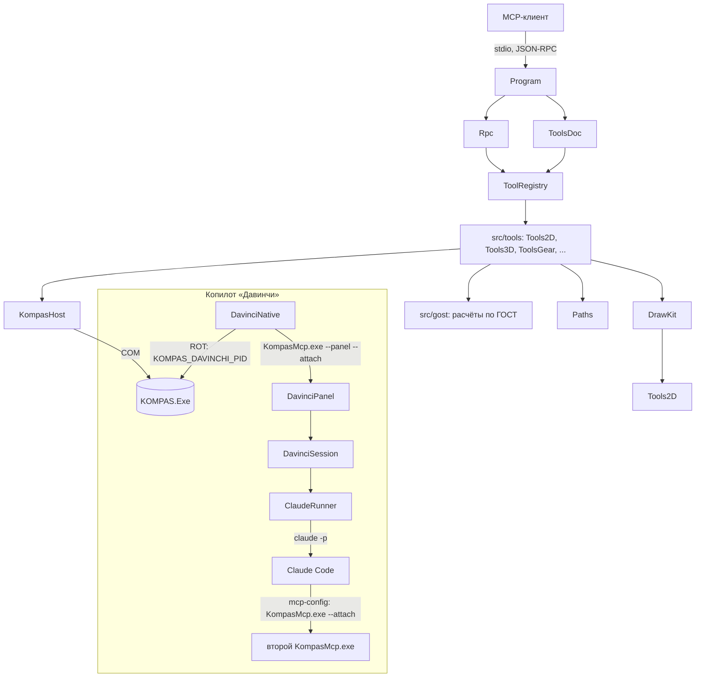

# kompas-mcp — справочник по классам

Документ для разработчика: из каких классов состоит сервер, за что отвечает
каждый, как они связаны и какие правила нужно соблюдать при доработке.
Параметры инструментов описаны в [tools.md](tools.md), работа пользователя —
в [руководстве оператора](operator-guide.md).

## Содержание

1. [Слои и связи](#1-слои-и-связи)
2. [Общие правила](#2-общие-правила)
3. [Ядро — `src`](#3-ядро--src)
4. [Инструменты — `src/tools`](#4-инструменты--srctools)
5. [Расчёты — `src/gost`](#5-расчёты--srcgost)
6. [Копилот — `src/davinci`, `src/Ui`](#6-копилот--srcdavinci-srcui)
7. [Библиотека КОМПАСа — `davinci`](#7-библиотека-компаса--davinci)
8. [Сборка, выпуск, тесты](#8-сборка-выпуск-тесты)
9. [Как добавить инструмент](#9-как-добавить-инструмент)
10. [Особенности API КОМПАС](#10-особенности-api-компас)

---

## 1. Слои и связи

Зависимости идут «вниз»: `src/gost` не знает ни о КОМПАСе, ни о протоколе;
инструменты знают о расчётах и о `KompasHost`, но не о JSON-RPC; `Rpc` знает
только реестр. Копилот — отдельная ветка: процесс панели сам инструменты не
выполняет, их выполняет второй экземпляр сервера, который `claude` запускает
по сгенерированному mcp-config в режиме attach.

## 2. Общие правила

**stdout — только протокол.** Любой посторонний вывод в stdout ломает
клиента. Диагностика — `Log.Write` / `Log.Error` (файл `kompas-mcp.log`
рядом с exe). Исключение — служебные ключи `--version` и `--tools-md`, после
которых сервер не запускается.

**Ошибки.** Ошибка, понятная пользователю (не хватает аргумента, нет
документа, операция не изменила тело), — `throw new ToolException("…")`: клиент
получит `result.isError = true` с этим текстом, и модель сможет исправить
вызов. Любое другое исключение превращается в протокольную ошибку `-32603`.
Сообщение пишется по-русски и говорит, что сделать.

**Единицы.** Длины — мм, углы — градусы (в 2D-API КОМПАСа — тоже градусы,
перевод в радианы — только для своих вычислений), силы — Н, моменты — Н·м,
напряжения — МПа, масса — кг.

**Пути.** Все пути к файлам перед передачей в КОМПАС проходят через
`Paths.Abs` (относительные — от папки exe), пути по умолчанию — через
`Paths.Out` (папка `mcp-out` рядом с exe). КОМПАС считает относительные пути
от своей рабочей папки, а у `ksSaveToDXF` относительный путь вешает скрытый
КОМПАС намертво.

**Текущий документ.** `Tools2D` и `Tools3D` держат в статических полях
текущий чертёж и текущую деталь или сборку; инструменты работают с ними, как
пользователь с активным окном. Составные инструменты (чертежи передач,
пары, сборочный чертёж) создают свои документы через те же методы
(`Tools2D.CreateDrawing`, `Tools3D.CreatePart`, `Tools3D.OpenPart`) и после
работы либо оставляют документ текущим, либо закрывают его
(`Tools3D.CloseCurrentDoc`). При `KompasHost.Stop` / `Detach` поля
сбрасываются (`Reset`), потому что COM-ссылки становятся мёртвыми.

**Проверка результата.** 3D-операции сравнивают массу до и после
(`Tools3D.ReliableMass`): КОМПАС часто «успешно» создаёт операцию, которая
ничего не меняет. Такую ситуацию инструмент превращает в `ToolException`.

**Потоки.** Обычный режим — один STA-поток (`Main` с `[STAThread]`): все
вызовы КОМПАСа последовательны. В режиме панели stdio-цикл работает в
фоновом потоке, панель — в своём STA-потоке; из панели к КОМПАСу обращается
только таймер статуса (`KompasHost.Status`).

**Строки и кодировка.** Исходники — UTF-8, компилятор вызывается с
`-codepage:65001`. Протокол — UTF-8 без BOM в обе стороны.

---

## 3. Ядро — `src`

### `Program`
Точка входа. Разбирает ключи: `--version`, `--tools-md [файл]` (справочник
и выход), `--attach` / `--rot-name` (передаются в `KompasHost`), `--panel`.
Обычный режим — `StdioLoop`: читает строки stdin, отдаёт каждую в
`Rpc.Handle`, ответ пишет одной строкой в stdout. По концу stdin вызывает
`KompasHost.Shutdown`. Режим панели (`PanelMain`) открывает окно «Давинчи»,
обслуживает stdio в фоне и живёт, пока окно открыто.

### `Rpc`
Диспетчер JSON-RPC 2.0. Методы `initialize`, `ping`, `tools/list`,
`tools/call`; сообщения без `id` (уведомления) игнорируются. Версия сервера —
константа `ServerVersion`. `tools/list` строится один раз и кэшируется: реестр
после старта не меняется. Результат инструмента сериализуется в JSON и
отдаётся единственным текстовым элементом `content`. `ToolException` →
`isError`; COM-ошибка «сервер RPC недоступен» → `KompasHost.Detach` и
понятный текст (КОМПАС закрыли — следующий вызов переподключится); любое
другое исключение — ошибка `-32603` с сообщением.

### `ToolRegistry`, `ToolDef`, `ToolException`
Реестр инструментов. Статический конструктор вызывает `Register()` каждого
класса инструментов внутри `In("Раздел", …)` — раздел попадает в `ToolDef.Section`
и в оглавление `tools.md`. `Add(name, description, schemaJson, handler)`
разбирает схему и записывает её одной строкой; битая схема — исключение при
старте, а не при вызове; повторное имя — тоже. `Find` — поиск по словарю.

Хелперы аргументов: `GetStr`, `GetDbl`, `GetInt`, `GetBool` — с умолчанием
или обязательные (без умолчания бросают `ToolException`). Числа принимаются
и строками в инвариантной культуре.

### `ToolsDoc`
Генератор `docs/tools.md` из реестра: оглавление по разделам, описание и
таблица параметров каждого инструмента. Справочник не правится руками —
после изменения описаний или схем его пересобирают (`--tools-md`,
делается в `package.ps1`).

### `KompasHost`
Жизненный цикл КОМПАСа.
- **Свой экземпляр**: `Start(visible)` создаёт `KOMPAS.Application.5`
  (каждый `Activator.CreateInstance` — новый процесс) и находит его PID
  разницей снимков процессов до и после; `Stop` отпускает ссылки и завершает
  только этот процесс; `Show` меняет видимость. Свойство `Kompas` запускает
  экземпляр при первом обращении.
- **Attach** (`--attach`): `TryAttach` ищет в ROT моникер `--rot-name`, затем
  любой `KOMPAS_DAVINCHI_*`, затем активный `KOMPAS.Application.5`. `Start`,
  `Show` запрещены, `Stop` = `Detach` (только отпустить ссылки).
- `IsRpcDead(e)` распознаёт «мёртвый» COM-объект (коды `0x800706BA`,
  `0x80010108`, `0x800706BE`); `Detach` сбрасывает ссылки и состояние
  инструментов.
- `Shutdown` — выход сервера: скрытый свой экземпляр закрывается, показанный
  (`kompas_show`) остаётся пользователю.
- `App7` — объект API-7 (`IApplication`) того же экземпляра; `Status()` —
  режим, PID, видимость, открытые документы.

### `Paths`
`Out(имя)` — путь в `mcp-out` рядом с exe (папка создаётся);
`Abs(путь)` — абсолютный путь, относительный считается от папки exe.

### `Log`
Потокобезопасная запись строк с отметкой времени в `kompas-mcp.log` рядом
с exe. Ошибки записи журнала глушатся — журнал не должен ронять сервер.

### `JsonLib.Json`, `JsonLib.RawJson`
Свой JSON без зависимостей. Модель значений: `Dictionary<string, object>`,
`List<object>`, `string`, `double`, `bool`, `null`. `Parse` и `Write`;
`RawJson` вставляет готовый JSON без экранирования (схемы в `tools/list`).
Тот же файл используется копилотом для разбора потока `claude`.

---

## 4. Инструменты — `src/tools`

Каждый класс — статический, с методом `Register()`, который добавляет
инструменты в реестр. Обработчик получает словарь аргументов и возвращает
словарь результата.

### `InfraTools`
`ping`, `kompas_status`, `kompas_start`, `kompas_show`, `kompas_stop`,
`list_open_documents` — тонкие обёртки над `KompasHost`.

### `Tools2D`
2D-чертёж: создание листа (`CreateDrawing` — формат, ориентация, макет с
рамкой и основной надписью формы 1, листовой вид в начале координат),
виды (`MakeView`), примитивы, размеры (`LinDim`, `DiamDim`, `RadDim`,
угловой), штриховка (`Hatch`, `HatchRect`), шероховатость, линия разреза,
группы размеров, основная надпись (через API-7 `IStamp`), технические
требования, сохранение, PNG (`RenderPng`), DXF, чертёж цилиндрического
колеса (`gear_drawing`).

Состояние: `doc` (текущий `ksDocument2D`), `DocPath`, номер текущего вида.
`GetDoc()` бросает `ToolException`, если чертежа нет. `FmtNum` — число без
лишних нулей для надписей.

### `DrawKit`
Оформление чертежей деталей передач на А3 альбомном (координаты — мм листа):
- `Fit` / `StdScale` / `ScaleText` — наибольший масштаб из ряда ГОСТ 2.302,
  при котором изображение с полями под размеры помещается левее таблицы
  и выше штампа, и положение вида по центру поля;
- `ParamTable` — таблица параметров в правом верхнем углу (колонки 75 и
  35 мм, строки 8 мм); длинный текст сужается, затем уменьшается кегль;
- `TechReq` — технические требования под таблицей с переносом строк;
  возвращает `false`, если не поместились над штампом;
- `Poly`, `Hatch`, `Dim`, `Wavy` — ломаные, штриховка, размер, линия обрыва;
  `mirrorY` — зеркальная половина осевого разреза;
- `Stamp`, `Finish` — основная надпись, сохранение и PNG; `TechItems` —
  требования пользователя или типовые.

### `Tools3D`
3D-деталь и сборка. Документ детали создаётся через API-7
(`Documents.Add`), дальше — API-5 (`ksPart`, `ksEntity`).
- Инструменты: деталь, эскиз (в т. ч. на смещённой плоскости), выдавливание
  и вырез, вращение, отверстие, фаска и скругление (рёбра выбираются точками),
  материал, масса, сохранение, рендер, сборка и компоненты.
- Помощники для составных инструментов (`internal`): `PolySketch` (эскиз
  из ломаных), `OffsetPlane`, `RevolveZ` и `RevolveCircle` (тела вращения
  вокруг глобальной Z), `Spiral` (цилиндрическая спираль), `Evolution`
  (кинематическая операция), `Loft` (по сечениям), `CircularCopyZ` (круговой
  массив), `EdgeOp` (фаска или скругление), `PlacePart` / `PlacePartAxes`
  (размещение компонента), `AddComponentImpl`, `ComponentInfos` (компоненты
  сборки с габаритами), `ReliableMass`, `CurrentMass`, `HideAux` (скрыть
  плоскости и оси перед рендером).

Состояние: `doc3D`, `doc7`, `part`, `partPath`, эскизы по номерам
(`sketchId`) и последний эскиз.

### `ToolsCalc`
`material_library`, `material_lookup`, `fit_calc`, `tolerance_it`,
`section_properties` — без КОМПАСа, поверх `Materials` и `GostEsdp`;
моменты инерции простых сечений считаются на месте.

### `ToolsStd`
`std_part`: болт, гайка, шайба, шпилька, цилиндрический и конический штифт,
шарикоподшипник — по таблицам `Fasteners`. Головка и гайка — шестигранник
по размеру «под ключ» и диаметру описанной окружности; подшипник — кольца
и тор дорожки вращением; конусность штифта 1:50 — фаской по образующей.
Материал по умолчанию — сталь 45.

### `ToolsGear`
`gear_calc` (геометрия ГОСТ 16532), `gear_wheel` (3D-колесо: эвольвентный
профиль ломаной из `Gost16532.ProfilePoints`, выдавливание, отверстие),
`gear_pair` (два колеса и сборка; фаза: зуб шестерни на +X, у колеса против
неё — впадина).

### `ToolsSpring`
`spring_calc` (ГОСТ 13765), `spring_drawing` (разрез пружины сжатия по
ГОСТ 2.401: сечения витков, видимые передние полувитки, размеры, таблица,
диаграмма испытаний при F1/F2), `spring_create` (3D: спираль + кинематическое
выдавливание круга; у пружины сжатия — поджатые и сошлифованные опорные
витки, у растяжения — зацепы).

### `ToolsSpc`
`spec_drawing`: спецификация ГОСТ 2.106 форма 1 на А4 книжном, нарисованная
примитивами. Разделы — в порядке ГОСТ, позиции — сквозные (кроме
документации), длинный текст ячейки сужается и уменьшается. Вложенный класс
`Row` — строка таблицы (заголовок раздела, запись, пустая).

### `ToolsBevelWorm`
`bevel_gear_drawing`, `worm_drawing`, `worm_wheel_drawing` — чертежи по
ГОСТ 2.405/2.406: главное изображение (осевой разрез колёс; червяк — вид с
местным разрезом витков), размеры, таблица параметров, технические
требования через `DrawKit`. Ось детали на листе горизонтальна; все дуги —
ломаными.

### `ToolsGear3D`
`worm_shaft`, `worm_wheel`, `bevel_gear_wheel`, `worm_pair`, `bevel_pair`.
Оси колёс — глобальная Z; профили зубьев — прямобочные 20°.
- Червяк: цилиндр с шейками, впадина — кинематический вырез трапеции по
  спирали, заходы — круговым массивом выреза.
- Червячное колесо: тело вращением до дуги впадин горловины, зубья — лофт
  венца с закруткой на угол подъёма, вершины подрезаются вращением по дуге
  горловины.
- Коническое колесо: заготовка вращением по `BevelGears.Blank`, впадина —
  вырез по сечениям, сходящимся к вершине делительного конуса (вершина — в
  начале координат), круговой массив.
- Пары: колёса сохраняются отдельными файлами, сборка ссылается на них
  (внешние компоненты) и расставляет по межосевому расстоянию.

### `ToolsCheck`
`gear_check`, `worm_check`, `spring_check` — без КОМПАСа, поверх `Strength`.
Возвращают вердикт, расчётные и допускаемые величины и `tech` — строки
технических требований для чертежа.

### `ToolsAsmDrawing`
`assembly_drawing`: открывает сборку, собирает `ComponentInfos`, группирует
одинаковые компоненты (тот же файл) в позиции (вложенный класс `Position`:
представитель, количество, раздел спецификации), создаёт ассоциативные виды
в проекционной связи, габаритные размеры, выноски позиций, штамп с «СБ» и,
если не отключено, спецификацию через обработчик `spec_drawing` тем же
списком позиций.

Выноски: полки — столбцом слева от главного вида, по высоте в порядке
точек-указателей, чтобы линии не пересекались. Точка-указатель — узел сетки
7×7 внутри проекции габарита экземпляра, который перекрыт проекциями
наименьшего числа других компонентов (из таких — ближайший к центру);
представитель позиции — экземпляр с самой левой точкой. Проекция точки
модели на вид — `GetProjectionPoint` поздним связыванием (в interop-сборке
SDK этого метода нет).

### `ToolsPartDrawing`
`part_drawing`: деталь `.m3d` (по умолчанию текущая, перед чертежом
сохраняется) → ассоциативные виды front/top/left в проекционной связи
(раскладка и подбор масштаба — как у сборочного чертежа), без невидимых линий,
с осевыми линиями. `section` заменяет вид разрезом А-А через середину детали:
сначала раскладываются обычные виды, затем на соседнем виде строится линия
разреза (`ICutLine.Points`; стрелки — в сторону взгляда заменяемого вида),
обычный вид удаляется и на его место ставится `vt_Section` с `BaseObject` —
линией разреза. Габаритные размеры, технические требования над штампом,
штамп из свойств модели (наименование, обозначение, материал).
`view_project` переводит точки модели в координаты вида этого чертежа
(`GetProjectionPoint`) и делает вид текущим — дальше обычные 2D-инструменты
наносят размеры в нём.

### `ToolsImage`, `ToolContent`
`image_view`: изображение целиком с сеткой 10×10 (подписи в долях 0…1) или
фрагмент `region`, увеличенный до `size` пикселей по длинной стороне
(WPF-imaging в отдельном STA-потоке). Результат — `ToolContent` из двух
элементов MCP: `image` (PNG в base64) и `text` (размеры исходника и фрагмента).
`Rpc.ToolsCall` отдаёт `ToolContent` клиенту как есть, остальные результаты —
JSON-текстом.

---

## 5. Расчёты — `src/gost`

Чистые функции без КОМПАСа. Чертёж и 3D-модель одной детали берут
геометрию из одного и того же метода — поэтому они всегда согласованы.

### `Gost16532`
Эвольвентное зацепление без смещения, исходный контур α = 20°.
`WheelGeom(m, z)` → `Wheel` (d, da, df, db, высоты головки и ножки,
толщина зуба, признак подрезания); `MeshGeom(m, z1, z2)` → `Mesh` (межосевое, передаточное число);
`ProfilePoints` — замкнутый профиль венца ломаной для эскиза;
`HalfAngleAtRad` — полуугол толщины зуба на радиусе.

### `BevelGears`, `BevelWheel`, `BevelBlank`, `WormGears`, `WormPair`
- `BevelGears.Wheel(me, z, δ, b)` — ортогональная прямозубая коническая
  передача по ГОСТ 19624 (внешние диаметры, конусы вершин и впадин, длина
  образующей); `MateDelta` — угол сопряжённого колеса.
- `BevelGears.Blank(...)` → `BevelBlank`: профиль заготовки (`Outline()`) —
  общий для чертежа и 3D.
- `WormGears.Worm(m, z1, q, z2)` → `WormPair` (ГОСТ 19672/19036: диаметры
  червяка и колеса, межосевое, угол подъёма γ); `ThreadLength`,
  `JournalLength`, `WheelWidth`, радиусы горловины `ThroatTipRadius` /
  `ThroatRootRadius`.

### `Gost13765`
Пружины: `Calc(d, D, n, t, G)` → `Spring` (индекс, коэффициент Валя,
жёсткость, H0, полное число витков, длина проволоки); `ShearStress` (с коэффициентом Валя).

### `Fasteners`
Таблицы `Bolt` (ГОСТ 7805), `Nut` (ГОСТ 5915), `WasherFor` (ГОСТ 11371) —
М6…М48; `Bearing(код)` (ГОСТ 8338, серии 200 и 300; диаметр отверстия: коды
00–03 → 10, 12, 15, 17 мм, далее ×5). `null` — номинала нет.
`HexVertices` — вершины шестигранника по диаметру описанной окружности.

### `GostEsdp`
Допуски и посадки до 500 мм по таблицам ISO 286 / ГОСТ 25346: `ItValue(квалитет, d)` —
допуск IT1–IT18 в мкм, `Fit("H7", "p6", d)` — отклонения полей, зазоры или натяги, тип
посадки. Основные отклонения валов a…u — по таблице с уточнёнными интервалами;
отверстий — по правилу перевода (для K, M, N до IT8 и P…U до IT7 — с поправкой Δ).
Неподдержанное поле или диаметр — `ToolException` с понятным текстом.

### `Materials`
Справочник материалов с плотностями: `List()`, `Find(имя)` — без учёта
регистра, по началу названия («сталь 45» находит «Сталь 45 ГОСТ 1050-88»).

### `Strength`
Проверочные расчёты: `Spur` (ГОСТ 21354 — контакт и изгиб, коэффициенты
нагрузки по скорости и степени точности), `Worm` (скорость скольжения, КПД,
самоторможение, прочность бронзового венца), `Spring` (силы, высоты,
напряжения, устойчивость). Результаты — классы `SpurResult`, `WormResult`,
`SpringResult` с расчётными величинами и признаком `Ok`; строки технических
требований из них составляет `ToolsCheck`.

---

## 6. Копилот — `src/davinci`, `src/Ui`

Панель — WPF без XAML-компиляции: разметка строится в коде, стили разбираются
при старте `XamlReader`-ом, поэтому сервер по-прежнему собирается одним `csc`
(ссылки на `PresentationCore`, `PresentationFramework`, `WindowsBase`,
`System.Xaml` — в `build.ps1`).

### `DavinciPanel`
Статический вход в панель, потокобезопасный: все вызовы маршалятся в поток окна
через его `Dispatcher`. Окно живёт в своём STA-потоке процесса
`KompasMcp.exe --panel` (`Dispatcher.Run`); одно на систему — именованный
мьютекс и событие «показать»: повторный запуск выводит окно вперёд и
завершается. Методы: `Start`, `WaitClosed`, `Close`; события сессии —
`Busy`, `AppendAssistant`, `ToolCall`, `ToolResult`, `TurnDone`, `Notice`,
`Error`, `RefreshClaudeStatus`. Обработчики окна: `SubmitHandler`
(`null` — эхо для отладки), `AbortHandler`, `NewDialogHandler`.

### `PanelWindow`
Окно чата: шапка (аватар, состояние КОМПАСа раз в 2 с по `KompasHost.Status`,
состояние Claude по `ClaudeStatusProvider` — полная проверка при открытии и по
щелчку, быстрая раз в 20 с; «Новый диалог», «Настройки»), полоса занятости,
лента в `ScrollViewer` (колесо всегда листает ленту), поле ввода с вложениями;
страница настроек (`SettingsPage`) заменяет ленту и ввод. Окно обычное
(`Topmost` — только при закреплении в настройках). Запрос — пузырь справа (выделяемый
`TextBox`), ответ — `RichTextBox` с документом из `Markdown.Build`. Ход
(`Turn`) — строка «Выполняю: …» / «Шагов: N · T с», раскрывающая список
инструментов; пока ход идёт, новые элементы встают над ней. Лента не
прокручивается сама, если пользователь читает выше. `ChatText` и `InputBox` —
для тестов. Тёмный заголовок окна — `DwmSetWindowAttribute` (атрибут 20).

### `Theme`, `Styles`, `Icons`, `Markdown`
- `Theme` — палитра из живых кистей: смена темы меняет их цвета, и всё окно
  перерисовывается само; `Publish` кладёт те же кисти в ресурсы для
  `DynamicResource` в шаблонах. Тема и положение окна — в
  `HKCU\Software\KompasMcp\Davinci`; без сохранённой темы — тема приложений Windows.
- `Styles` — шаблоны кнопок (иконка, отправка, пример запроса) и тонкой полосы
  прокрутки; `Icon` — контурная иконка 24×24 по строке пути из `Icons`.
- `Markdown.Build` — разметка ответа в `FlowDocument`: заголовки, абзацы,
  вложенные списки, цитаты, код, таблицы, черта; в строке — жирный, курсив
  (не срабатывает внутри `snake_case`), `код`, ссылки; пути к файлам
  `C:\…\*.cdw|m3d|a3d|…` — ссылки, открывающие файл.
- `SettingsPage` — страница настроек: источник нейросети (Claude Code, Ollama,
  другой API) с адресом, ключом и моделью (подсказки-варианты; модели Ollama —
  с `/api/tags`), «Проверить» (`ClaudeProbe.TestNow` по ещё не сохранённым
  полям), работа (папка, лимит, команда), окно (тема, «поверх окон»). Результат
  — копия `DavinciConfig`; применяет её `PanelWindow` через `DavinciSession.Apply`.
- `ServiceState` — состояние службы для индикатора: `Ok`, текст, подробности,
  `Hard` (запрос отправлять бессмысленно).

### `DavinciSession`
Связывает панель и `ClaudeRunner`. `Init` читает конфиг и пишет mcp-config;
`Submit` запускает `claude` в фоне (один запрос одновременно), продолжая
разговор по `session_id` предыдущего ответа; `Reset` начинает новый диалог;
`Abort` и `Shutdown` останавливают запрос. События потока превращаются в
события панели: текст ответа, шаги инструментов (все `tool_use` сообщения),
ошибки инструментов, итог хода. Итог `result` повторяет последний текст
ответа, поэтому выводится, только если текста в ходе не было; стоимость не
показывается (при стороннем `ANTHROPIC_BASE_URL` она считается по тарифам
Anthropic). Системный промпт — правила для модели в КОМПАСе пользователя
(не вызывать `kompas_stop`, не сохранять без просьбы, читать вложения и т. д.).

### `ClaudeRunner`, `ClaudeRunnerOptions`
Запуск `claude -p --output-format stream-json --verbose` через `cmd /c` с
сообщением в stdin (кириллица и кавычки в argv ломаются). Перед запуском
доливает в окружение переменные пользователя из реестра (процесс панели
наследует окружение КОМПАСа; пользовательские перекрывают машинные, как в
Windows) и `env` из конфига. События: `OnEvent`, `OnError`, `OnExit`; stderr
`claude` пишется только в журнал, итог и ошибки API — в журнал целиком. `Stop` — `taskkill /T /F` всего дерева
процессов; таймаут — сторожевым таймером.

### `StreamJson`, `StreamEvent`
Разбор строки потока `claude`: тип события (`system`, `assistant`, `user`,
`result`), `session_id`, текст, имена вызванных инструментов (`ToolNames`),
модель (`<synthetic>` — сообщение `claude` об ошибке API), признак ошибки
инструмента (`ToolResultIsError`), итог.

### `McpConfig`
Пишет `%TEMP%\kompas-davinci\mcp-config.json`: сервер `kompas-mcp` — этот
же `KompasMcp.exe` с ключом `--attach`.

### `DavinciConfig`
Настройки из `davinci.json` (рядом с exe или в `davinci\`): источник нейросети
(`Provider`: `claude`, `ollama`, `api`; без него — по `ANTHROPIC_BASE_URL` в
`env`, как в старых конфигах), адрес, ключ, модель, путь к серверу, рабочая
папка, команда `claude`, таймаут, окружение. `EffectiveEnv` — окружение claude:
переменные источника (для Ollama и API — адрес, токен и одна модель на все
алиасы), поверх — `env`. `Save` пишет в тот же файл, сохраняя неизвестные ключи;
при явном источнике управляемые им переменные из `env` убираются.

### `ClaudeProbe`
Состояние Claude для индикатора и кнопки «Проверить»: Claude Code в PATH,
HTTP-доступность API (TLS 1.2), для стороннего API — запрос на 1 токен к
`/v1/messages`, для входа Claude Code — короткий `claude -p`. `EffectiveModel` —
модель для `--model`: со сторонним API имя передаётся явно (иначе claude
дописывает к алиасу суффикс вроде `[1m]`, и сервер отвечает «invalid model
name»). `Friendly` — понятная причина по тексту ошибки.

---

## 7. Библиотека КОМПАСа — `davinci`

### `DavinciNative` (`davinci/src/DavinciNative.cs`)
Управляемая сборка, которую КОМПАС грузит как нативную библиотеку `.rtw`.
Экспорты `LIBRARYID`, `LIBRARYNAME(W)`, `LIBRARYENTRY`,
`LibInterfaceNotifyEntry`, `LibInterfaceNotifyDisconnect`,
`LibIsOnApplication7` добавляются на этапе сборки (`build-native.ps1`:
ildasm → `inject_exports.py` вставляет `.export` / `.vtentry` → ilasm). Меню
«Давинчи» — Win32-ресурсы из `lib.rc`.
- `LibInterfaceNotifyEntry` получает объект приложения и регистрирует его в
  ROT под `KOMPAS_DAVINCHI_<PID>`; `Disconnect` — снимает регистрацию.
- `LIBRARYENTRY(1)` — запуск панели (`KompasMcp.exe --panel --attach
  --rot-name …`), `LIBRARYENTRY(2)` — диагностика.
- Первым делом ставит `AssemblyResolve` на свою папку: CLR ищет
  зависимости у KOMPAS.Exe, где interop-сборок нет.

### `DavinciLauncher`, `DavinciLog` (`davinci/src/DavinciLib.cs`)
Общий код библиотеки: `OpenPanel` (поиск сервера по `davinci.json`, затем рядом
с библиотекой; запуск без консольного окна; ошибка — текстом для сообщения
в КОМПАСе), журнал `%TEMP%\kompas-davinci\davinci.log`.

---

## 8. Сборка, выпуск, тесты

| Файл | Назначение |
|---|---|
| `build.ps1` | `csc` из .NET Framework 4 (x64, `-codepage:65001`), все `src/**/*.cs`; interop-DLL из `lib\`, папки уровнем выше или через `interop.ps1`; иконка — `davinci\avatar.ico` |
| `interop.ps1` | interop-сборки из `<КОМПАС>\SDK\lib\*.tlb` утилитой TlbImp |
| `package.ps1` | сборка, `--tools-md docs\tools.md`, архив `dist\kompas-mcp-<версия>-win64.zip` без DLL ASCON |
| `davinci\build-native.ps1` | библиотека `DavinciNative.rtw` (нужны ildasm, ilasm, rc и Python) |
| `davinci\gen_avatar.ps1` | аватар «Давинчи»: `avatar.svg` → `avatar.png` (256) и `avatar.ico` (16–256); SVG растеризует Edge или Chrome |
| `tests\protocol_test.ps1` | протокол без КОМПАСа: initialize, уведомление, ping, tools/list, вызов, неизвестный метод |
| `tests\run_smoke.ps1` | прогон сценария `smoke_*.jsonl` с записью stdin в UTF-8 |
| `tests\smoke_*.jsonl` | сценарии с живым КОМПАСом — перечень в README |
| `tests\*_test.cs`, `build_*_test.ps1` | копилот: разбор потока, сессия, панель, кодировка, вложения, сквозной сценарий |

Версия — `Rpc.ServerVersion`; `KompasMcp.exe --version` её печатает, а
`package.ps1` берёт из него имя архива.

## 9. Как добавить инструмент

1. Выберите класс по разделу в `src/tools` или создайте новый
   `ToolsX.cs` со статическим `Register()`; если класс новый — добавьте
   `In("Раздел", Tools.ToolsX.Register)` в конструктор `ToolRegistry`.
   Список исходников править не нужно: `build.ps1` берёт все `*.cs`.
2. Зарегистрируйте: `ToolRegistry.Add("имя", "описание", схема, a => …)`.
   Описание пишется для модели: что делает, единицы, умолчания, что
   возвращает. Схема — verbatim-строка с удвоенными кавычками; у каждого
   параметра — `description`, у обязательных — `required`.
3. Аргументы — через `ToolRegistry.Get*`, ошибки пользователя —
   `ToolException`, пути — через `Paths.Abs` / `Paths.Out`.
4. Расчёт, не зависящий от КОМПАСа, — в `src/gost`, чтобы его могли
   использовать и чертёж, и 3D, и проверки.
5. Для 3D проверьте изменение массы; для чертежа — PNG (`png`): «удачный»
   вызов API ещё не значит, что геометрия правильная.
6. Добавьте сценарий `tests\smoke_<тема>.jsonl` (заканчивается
   `kompas_stop`) и прогоните его `run_smoke.ps1`.
7. Обновите справочник: `KompasMcp.exe --tools-md docs\tools.md`.

## 10. Особенности API КОМПАС

Проверенное пробами поведение КОМПАС-3D v22, которое не следует из
документации SDK или противоречит ей. Учтено в коде; при доработке —
не наступать повторно.

**Процесс и документы**
- Каждый `Activator.CreateInstance("KOMPAS.Application.5")` поднимает новый
  процесс; PID — только снимком процессов.
- `0x80040154` после переустановки — COM-классы регистрируются первым
  ручным запуском КОМПАСа.
- Деталь создаётся через API-7 `Documents.Add(ksDocumentPart, true)`:
  `true` — невидимо, с `false` в скрытом КОМПАСе возвращается `null`. Корень
  детали — `GetPart(pTop_Part)`, не `pNew_Part`.
- КОМПАС резолвит относительные пути от своей рабочей папки; `SaveAs` с
  относительным путём или в несуществующую папку молча ничего не пишет;
  `ksSaveToDXF` с относительным путём вешает скрытый КОМПАС без окон и
  диалогов.
- `GetMass` кинематического тела — 0 до переоткрытия файла; масса берётся
  через `ReliableMass`.
- `GetGabarit(full = true)` включает вспомогательные плоскости (±25 мм) —
  для тел брать `full = false`.

**2D**
- `ksHatch(style, angle, step, width, x0, y0)`: четвёртый параметр —
  ширина полосы штриховки (0 — сплошная), а не x0. Границы — все примитивы
  между `ksHatch` и `ksEndObj`.
- Штриховка перетекает через примыкающие углы соседних контуров одного
  блока: сложную область штриховать разнесёнными простыми контурами
  с зазором 0,5 мм без обводки, обводку рисовать отдельно. Дуги в контуре
  штриховки ненадёжны — окружности сечений штриховать многоугольником.
- Линия разреза API-7 (`ICutLine`): концы и изломы задаются только массивом
  `Points` (x0, y0, …, xn, yn); `X1/Y1/X2/Y2` — положения букв, а не концов
  линии. Буквы КОМПАС ставит при создании линии и при последующем переносе
  и масштабировании вида уводит их далеко от неё — линию строить на уже
  размещённом виде и задавать буквы явно (точка привязки — левый нижний угол).
  Вид-разрез: `Views.Add(vt_Section)`, `BaseObject` = линия разреза,
  `Section = false` (разрез, а не сечение).
- `ksArcByPoint` (инструмент `arc`) рисует дугу правильно — проверено на v22,
  в том числе в контуре штриховки. С `ksArcBy3Points` и `ksArcByAngle`
  наблюдалась полная окружность вместо дуги, поэтому генераторы чертежей
  рисуют частичные дуги ломаными; `ksCircle` работает правильно.
- Размеры: `dx`/`dy` и `textPos` — в мм листа и абсолютные; `textBase = 0`
  — текст по центру; `ps` задаёт тип (0 — горизонтальный,
  1 — вертикальный, 2 — параллельный), без него размер ложится вдоль
  отрезка. Диаметральный размер — `ksDiamDimension` с `ksRDimParam`;
  радиальный со знаком «R» — `sign = 3`. Префикс — флаг `_PREFIX` и строка
  в `GetTextArr()`.
- Угол `ksText` — в градусах. Ширина символа шрифта ГОСТ ≈ 0,8 высоты.
  Греческие буквы и знаки ′ ″ шрифт основной надписи не рисует.
- Основная надпись — через API-7 `IStamp.Text[ksStampEnum]` и
  `stamp.Update()`. Имена ячеек обманчивы: `ksStPartNumber` (1) — графа 1
  «Наименование изделия», `ksStDescription` (2) — графа 2 «Обозначение
  документа», которую КОМПАС повторяет в графе 26. В коде — константы
  `Tools2D.StampName` и `Tools2D.StampDesignation`.
- Спецификация `lt_DocSpc` в скрытом режиме не создаётся
  (`ksCreateDocument` → `false`, разделы не навешиваются) — поэтому она
  рисуется таблицей на обычном листе.

**3D**
- Вращение требует осевой линии стиля 3 в эскизе, а профиль не должен
  примыкать к оси — иначе `Create` возвращает 0. Конус штифта поэтому
  строится фаской по образующей.
- Эскиз на XOZ: глобальная Z = −y эскиза, x = X. Локальные оси XOZ/YOZ
  легко перепутать — проще XOY со смещением.
- Вырез выдавливанием в v22: при `side = true` режется половина глубины —
  использовать направление «в обе стороны».
- Спираль: `turnDir = true` — правая винтовая линия.
- Лофт по замкнутому контуру венца даёт сплошной диск — отверстие резать
  после.
- `ksPlacement.SetAxes(ox, oy)` принимает векторы, а `GetAxis` возвращает
  точку «начало + орт»; поочерёдный `SetAxis` ломается, если OY выходит
  из плоскости XY.
- Рендер сборки: флаги скрытия плоскостей действуют на вставки только при
  `HideInComponentsMode = true` — ставить и для вставок, и для документа.
- Растр `SaveAsToRasterFormat` работает и при скрытом окне.

**Библиотека и окружение**
- `.rtw` загружается нативно: CLR ищет зависимые сборки у KOMPAS.Exe —
  нужен `AssemblyResolve` на папку библиотеки. Пока КОМПАС держит `.rtw`,
  пересобрать её нельзя.
- `lib.rc` в UTF-8 требует `#pragma code_page(65001)`, иначе меню — мусор.
- Конвейер PowerShell перекодирует stdin в OEM-кодировку: кириллица в
  аргументах превращается в `?`. Сценарии запускать через `run_smoke.ps1`.
- `claude mcp add` после `--` теряет обратные слэши — путь к серверу
  прямыми слэшами.
